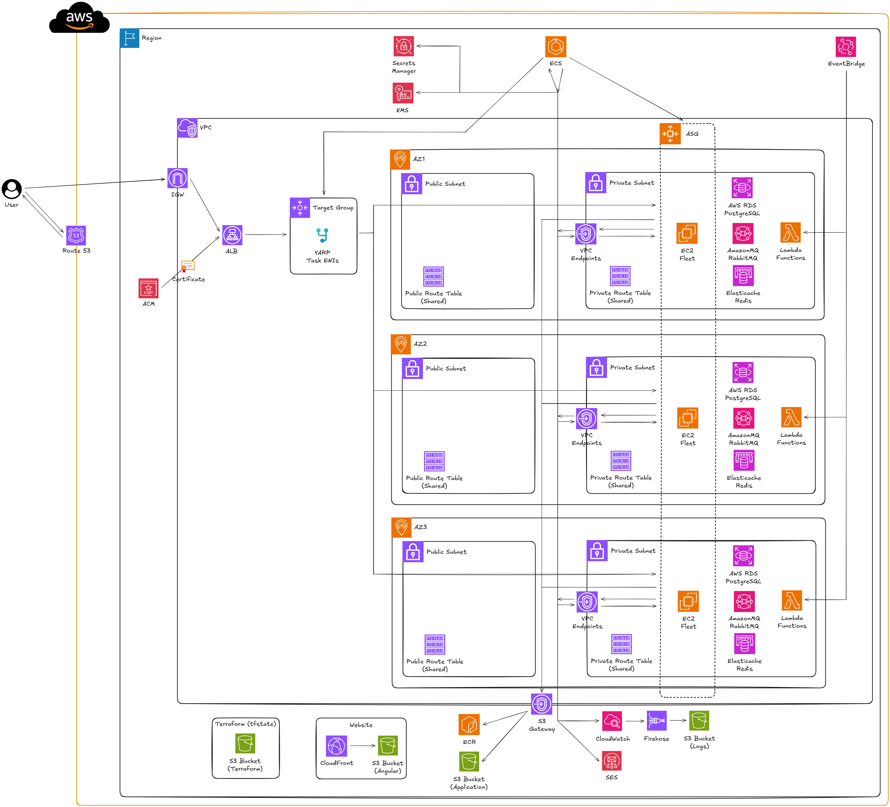
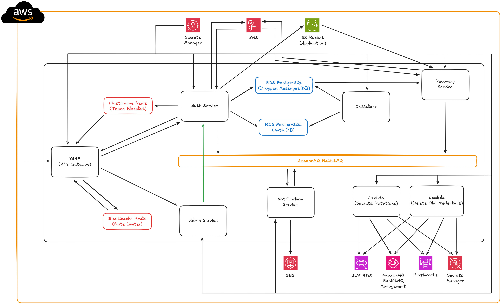

# AWS Microservices Monorepo
This repository is a template project to practice and show my AWS and microservices skills. Still, the template is built for production use and can provide a foundation for new projects. It also respects mandatory security and compliance requirements and is built with multiple Availability Zones (AZs) for High Availability (HA).

Furthermore, I purposely avoided using too many 3rd party packages to prevent supply-chain attacks. The packages that are used in this template are as follows:

- `Microsoft`: Microsoft packages are used for authentication utilities, EF Core, YARP (API gateway) and tests (Web Application Factory etc.).
- `grpc-packages` & `protobuf-packages`: gRPC related packages are used for internal synchronous communication between microservices.
- `RabbitMQ`: The RabbitMQ client package is used for internal asynchronous communication between microservices.
- `Npgsql`: Npgsql packages are used on top of EF Core to communicate with AWS RDS PostgreSQL on AWS.
- `StackExchange`: Stackexchange packages are used to communicate Elasticache Redis on AWS.
- `AWSSDK`: AWSSDK packages are used to communicate with AWS services.
- `Testcontainers`: Testcontainers are used to simulate real production environment (including AWS) to ensure that everything works as intended. (Testcontainers packages do not end up in the production code.)
- `BouncyCastle.Cryptography`: This crypto package is used in a lambda function rotating secrets to issue new certificates for microservices.

## AWS Setup

The flow of a request made by a user is as follows:

- The user connects to the website and makes a request to the backend.
- The user resolves the domain name with Route53 and receives the IPs of the Application Load Balancer (ALB).
- The user sends the request to the ALB via the Internet Gateway (IGW).
- The ALB terminates TLS with AWS Certificate Manager (ACM).
- The ALB chooses a healthy YARP (API gateway) from the Target Group, which is filled by Elastic Container Service (ECS).
- The ALB communicates with the API gateway over TLS to keep the communication encrypted. (All microservices have custom certificates.)
- The ALB sends the request to the API gateway while adding a forwarded for header (XFF).
- The API gateway proxies the request to the related downstream service.
- The response of the request comes back to the API gateway and returns back to the ALB and then to the user.

More technical information about the AWS setup is in the [AWS Setup Documentation](./docs/1-aws-setup.md).

## Microservices Setup

(The image above does not show how microservices are distributed over the EC2 fleet for simplicity.)

### YARP (API Gateway)
The purpose of the API gateway is to proxy all requests to downstream services while transforming these requests and doing authorization checks. In this setup, if a JWT Bearer token is present in an incoming request, the API gateway validates the token with the public keys returned from the JWKS endpoint of the auth service. If the token is valid, the API gateway checks if the token is blacklisted. If so, the API gateway treats the request as if the request did not have a JWT Bearer token in its headers. If not, the API gateway puts the claims of the token to the headers for the downstream services. Once the transforms and authorization checks are done and the request is allowed through to the downstream service, the API gateway checks the rate limit of the sender. If the rate limit is reached, the API gateway rejects the request and returns a response. Otherwise, the request is proxied to the related downstream service.

### Auth Service
The purpose of the auth service is to handle all accounts and their authentication/authorization. In this setup, when an endpoint requiring asynchronous communication with the other services is called, the auth service publishes a message to the related RabbitMQ queue for the consumers. For any reason, if a message could not be put into a queue, the auth service retries putting those messages into their related queues for a specific number of times. Once this number is reached, the auth service then saves these dropped messages to a database (DB) while encrypting the content of the messages. In case of a failure while saving the dropped messages to the DB, the auth service saves these messages to an S3 Bucket as the fallback mechanism (still encrypted). These messages are then picked up by the recovery service to be republished them until they are put into related queues.

The auth service also exposes well-known endpoints for the API gateway to retrieve the public keys of the RSA pairs that are used for forging bearer tokens. Furthermore, when an endpoint requesting blocking forged bearer tokens of an account is called, the auth service adds all forged Bearer tokens of the account to the token blacklist.

### Admin Service
The purpose of the admin service is to handle administrative operations such as managing accounts and roles. Since this is a downstream service requiring synchronous operations, the admin service uses gRPCS (secure) to talk with the other services, which is shown with green arrows in the image. (In this template, the admin service talks only with the auth service.)

### Notification Service
The purpose of the notification service is to send notifications to users. The notification service constantly consumes the notification related RabbitMQ queues. During the sending process, if any notification fails, the notification service requeues the related message while adding a header to track how many times this message has failed. If the retry count of the message reaches a specific number, the notification service publishes the message to the dead letter queue (DLQ) for that specific type of the message for manual handling.

### Recovery Service
The purpose of the recovery service is to republish dropped messages that are in the DB or the S3 Bucket. The recovery service does this process in batches to not throttle RabbitMQ. Once the messages are republished, the recovery service deletes the republished messages from the DB or the S3 Bucket depending on where these messages come from.

### Initializer
The purposes of the initializers are to set up the infrastructure services. In this setup, there is only one initializer, and this initializer runs the migrations of all DBs in the system and exits afterwards. Once this process exits, the other services start to spin up. This initializer can also be used to seed data or update the existing DBs via migrations.

### Lambda Functions
In this setup, there are 2 different types of lambda functions running inside the Virtual Private Cloud (VPC). The reason for that is that these lambda functions require connections to AWS RDS and AmazonMQ inside the VPC to rotate the secrets that are used in services. The lambda function rotating secrets is responsible for updating each service's credentials that are used for AWS RDS, AmazonMQ and Elasticache, as well as the JWT RSA key pair and services' certificates. Once this operation is completed, this lambda function saves the old credentials, so that the other lambda function can know which credentials should be deleted from the infrastructure services. The other lambda function then picks up these credentials and starts deleting them.

More technical information about the microservices setup is in the [Microservices Setup Documentation](./docs/2-microservices-setup.md).

## Todo List

- `Remaining HTTP and gRPC Endpoints`: Currently, there are still a few endpoints to create in the auth service and admin service.
    - For auth service: Resend verify email, Update email, Update password, Refresh token
    - For admin service: Ban account, Unban account, Soft delete account, Create role, Add role to account(s), Remove role
- `Terraform`: Currently, the AWS setup is not fully converted to Terraform. This Terraform will allow anyone to deploy the entire system on AWS easily.
- `Angular Website`: Currently, the website is not fully completed. This website will allow anyone using the template to interact with the entire system on the website.
- `Complete CI/CD`: Currently, the GitHub Actions CI runs only for the backend. There will be another workflow to check the Angular website's test cases as well. Additionally, there will be a different branch `production` for the CD workflow too (automatic deployment).
- `Extra Documentation`: Once the entire template is completed, there will be an extra documentation to show how to set up the entire system on AWS. (Terraform will mostly handle the setup on AWS.)
