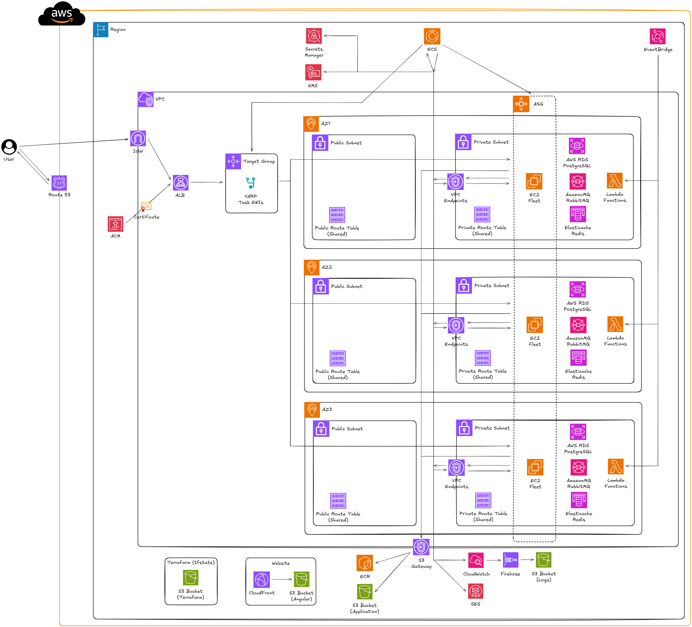

# AWS Setup

## General Setup
The template assumes that the project is deployed in 1 region with multiple Availability Zones (AZs) for High Availability (HA). In this setup, therefore, there is 1 Virtual Private Cloud (VPC) and 3 AZs in this VPC for load balancing and HA. In each AZ, 1 Public and 1 Private Subnets are also created to host the infrastructure. These public subnets share 1 Route Table, and likewise, the private subnets share 1 route table as well. This decision is made since there is no isolation is needed between the same type of subnets. For instance, there is no NAT Gateway for HA for each private subnet to have different routing.

## Microservices & AWS Services Deployments
In private subnets, an EC2 fleet is created inside an Auto Scaling Group (ASG) to deploy microservices. The reason for the ASG is to let Elastic Container Service (ECS) manage the number of EC2 instances via ECS Capacity Provider. So that, depending on the current load, the ECS can spin up or spin down EC2 instances (horizontal scaling). For the persistence part of the setup, AWS RDS, AmazonMQ and Elasticache are also deployed in these private subnets using multi-AZ deployment, which creates 3 instances spread across all AZs.

During the deployment of the microservices (or tasks in ECS terms), ECS agents fetch container images from Elastic Container Registry (ECR), which are uploaded beforehand. Since the ECR keeps these container images inside its own S3 Bucket, an S3 Gateway is used to fetch the container images fast and cheap. This S3 Gateway is also used among all tasks to access the application-wide S3 Bucket, which separates the data via key prefixes (folder-like). For the rest of the AWS services that the tasks need to reach, VPC Endpoints are created for each private subnet.

Furthermore, each task in this setup gets its own Elastic Network Interface (ENI) since the ECS is set to the awsvpc mode. Therefore, the ECS manages the Target Group that is created in the VPC to put the IPs of the YARPs (API gateway) instances inside the target group. By doing this, when unhealthy API gateway instances are redeployed (or a new version starts to roll out), the IPs in the target group are updated accordingly.

For service discovery, since the ENIs are dynamic, Cloud Map is used to give a dedicated DNS name to each microservice, so that the microservices can find and communicate each other within the VPC even when they are redeployed.

## Security
The template assumes that internal traffic must be encrypted all the time for security and compilance reasons. To ensure this, a custom root Certificate Authority (CA) along with an intermediate CA are created offline. Each microservice is then issued server certificate and opens ports only for HTTPS and/or gRPCS. By doing this, TLS handshake is forced inside the entire AWS for the encrypted traffic. The only exception for this is the health endpoints of the workers that only process data, such as notification service, which exposes a port for plaintext HTTP. Since this only endpoint carries a message if the task healthy or not, the unecrypted traffic does not matter here.

To give the issued server certificates to the tasks, the Secrets Manager is used to save the certificate values to keep them encrypted and safe. However, these secrets are not given by ECS agents. Instead, each task fetches its own secret values from the Secrets Manager at startup. The reason for that is the fact that environment variables that are given by ECS agents are not considered secure if the data carries sensitive data, since this data might end up in console outputs and logs. Alongside with certificate values, Secrets Manager also holds the credentials of the services to access the infrastructure services such as AWS RDS, AmazonMQ and Elasticache. Each task gets its own credentials that are needed for the infrastructure services.

To rotate these certificates and credentials, 2 Lambda Functions are used inside the VPC since these lambda fuctions need to access the infrastructure services. The EventBridge fires one of the lambda functions every 3 months on the 1st of the month, and this lambda function rotates the JWT RSA key pair, service certificates and credentials. Once the new values are saved to the Secrets Manager, the function starts a new rollout for the tasks. The other lambda function then runs to delete the old credentials that exist in the infrastructure services. By doing this, a full rotation of the secrets is completed. The time period between these lambda functions is adjusted to 7 days, which means the second lambda function runs every 3 months on the 7th of the month. This grace period gives enough time to fix or manually handle secrets that could not be rotated by the first lambda function while keeping the services running with the old credentials in case of a failure.

Since a task may or may not talk with the AWS services, while deploying the tasks, ECS agents also inject specific Identity and Access Management (IAM) role for each service to limit how a task interacts with AWS. This role ensures that a specific type of a task has a specific set of access rules for AWS services, including which secret values in the Secrets Manager a task can access.

Furthermore, the Key Management System (KMS) is used for encryptions inside the tasks, such as direct encryption-decryption via KMS or generating a data key for envelope encryption.

`NOTE`: In this template, the certificate creations and rotations are managed over the lambda functions and Secrets Manager. This was purely to save cost on AWS while developing the template. For real-world applications, this certificate system can be changed to ECS Service Connect with AWS Private CA. By doing this, the service discovery and the rotation of the certificates are managed by the ECS. In this case, Cloud Map and the secret values holding certificate values in the Secrets Manager can removed, which makes the management of the certificates and their rotations easier. Furthermore, this approach makes `BouncyCastle.Cryptography` package to be redundant as well since the ECS handles the rotation. Currently, AWS Private CA alone costs $400 per month by November 2026.

## Public-Facing Part
The public-facing part of the VPC consists of an Application Load Balancer (ALB), Internet Gateway (IGW), AWS Certificate Manager (ACM) and Route53. When a user makes a request to the backend, Route53 resolves the domain name and returns the IPs of the ALB. The user then send the request to the IP. This request enters the VPC via IGW and hits the ALB. ALB then terminates the TLS with ACM and chooses a healthy API gateway to send the request to the backend over TLS, which keeps the communication encrypted.

## Logs
The logs of the tasks are collected from the container stdout and stderr by ECS agents. These logs are then sent to CloudWatch via the related VPC endpoint with a time-to-live (TTL) of 14 days. Once these logs are in the CloudWatch, Firehose starts saving these logs to a dedicated S3 Bucket for persistance storage. The TTL here is set to reduce save some cost since the logs on CloudWatch can be expensive.

## Website
The Angular Single-Page Application (SPA) website is deployed on a dedicated S3 Bucket. For domain name and DDOS attack prevention, CloudFront is also set in front of the S3 Bucket.

## Terraform
For the terraform states, a dedicated S3 Bucket with the state lock and versioning mechanisms is used. This ensures that the terraform state is locked while `plan` or `apply` is running, and in case of a corrupted state file, the old state can be recovered from the old versions of the S3 Bucket.
