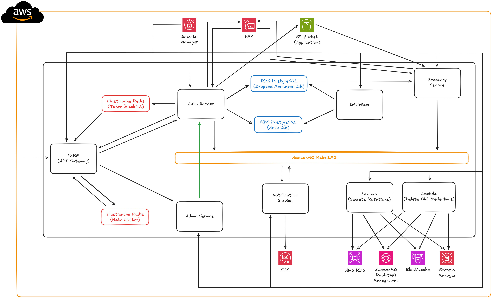

# Microservices Setup

(The image above does not show how microservices are distributed over the EC2 fleet for simplicity.)

## Asynchronous Communication
The asynchronous communication between microservices is implemented using the message broker, RabbitMQ. In the template, this asynchronous communication (publish and consume messages) is centralized by creating a publisher base class and two background service base classes to handle the retry mechanisms, publisher confirms and graceful shutdown.

- `Publisher Base Class`: This base class is used to centralize the message publishing process. Each publisher class holds its own channel and locks the channel with a semaphore while a message is being published (since channels in RabbitMQ are not thread safe). In this publishing process, channels also handle the publish confirms in an asynchronous manner. While a message is being published, the publisher class adds the message to the pending messages list and the channel waits until the message reaches RabbitMQ. Once the message is in RabbitMQ, what happens to the message is tracked asynchronously in the publisher class via the events fired by RabbitMQ. If the fired event is a return or not acknowledged event, the message is removed from the pending messages list and is put into the dropped messages list for retry. If the fired event is an acknowledged event, the message is simply removed from the pending messages list. This asynchronous tracking decision is made to achieve the maximum throughput per publisher class.

    The trade-off of this maximum throughput decision is that when the channel drops, the tracking events for the messages that are sent over this dropped channel are not fired. To overcome this problem, the asynchronous communication is coded based on the at-least-once delivery semantic, which means all of the pending messages that are sent over the dropped channel are treated as dropped messages and the publisher class retries sending these messages again. This may or may not cause duplicated messages in RabbitMQ. The responsibility of handling these duplicated messages is left to consumers in this approach if duplication is critical, which means consumers must use some values inside the message content or some values in the header values of the message or the correlation IDs to ensure that no duplication happens. The publishers in this case can also help to prevent duplication by providing some header values in messages if applicable.

- `Publisher Background Service Base Class`: This background service base class is responsible for all publishers in a service to handle the retry mechanisms and the graceful shutdown. For the messages that exceed the retry count, the background service calls a method to initiate the saving dropped messages process. While this method is called, the background service also gives a boolean parameter to inform the microservice whether this saving process is the last chance to save the dropped messages (whether the application is shutting down). Based on this parameter, the microservice can try different saving strategies, such as waiting until the application shutdown or using a fallback mechanism if the application is shutting down. In case of the application shutdown, the background service waits for a specific number of seconds before calling the save dropped messages method. This gives enough time for the publishers in the microservices to receive the results of the tracking events for the pending messages. Once the wait time is over, the background service combines the pending and dropped messages and calls the method for the last time.

- `Consumer Background Service Base Class`: This background service base class is responsible for a consumer's consume event and retry mechanism for the connection and channel. Once the background service consumes a message from a queue, the background service calls a method to inform the consumer. The consumer then has full responsibility for the message to handle, such as acknowledging or not acknowledging the message or retry mechanism for the message or sending the message to a dead letter queue (DLQ) etc.

## Synchronous Communication
The synchronous communication between microservices is implemented using gRPCS (secure), which is marked with green arrows in the image. When a microservice initiates a gRPC connection to another microservice, the caller resolves the DNS name of the destination with Cloud Map, which returns the IPs of the healthy instances of the target service. The caller then uses the round-robin load balancing strategy to choose one of the IPs. For the retry mechanism in case of failure, the caller uses an exponential-backoff retry mechanism to resend the request up to a specific number of times.

## Token Blacklist
The token blacklist in this template blocks all forged tokens before a specific date and allow any token that are forged after that date. This decision was made to avoid saving and tracking every token forged by the auth service, so that the blacklisting logic can be kept simple. An entry in this token blacklist, therefore, consists of an account ID, the date that the request is made and the lifespan of a token as the time-to-live (TTL).

## Rate Limiting
The rate limiter splits users into three categories to limit how many requests they can send per minute. These categories are Admin, Authenticated and Not Authenticated. If the request comes from a known account, the rate limit is applied to the account ID and the user's IP address while admins have a higher rate limit. If the request comes from a user who is not authenticated, the rate limit is applied only to the user's IP address.

## Microservices

More information about the microservices themselves is in the [README](../README.md).
